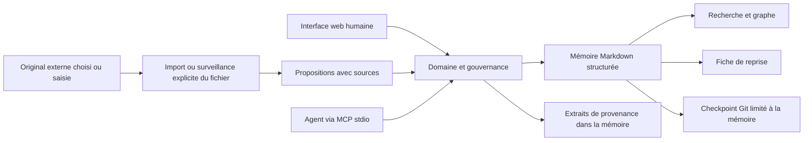

# ADR-0001 — Une mémoire locale lisible, gouvernée par statuts explicites

Date : 15 octobre 2026. Auteur et synthétiseur : agent produit/architecture. Statut : retenu pour l'implémentation v0.1 après revues domaine et interface ; conformité de livraison en attente des preuves du gate. Ne remplace aucune décision antérieure. [Synthèse et réserves](../testing/review-synthesis.md).

Adaptation du modèle AIWG `templates/governance/adr-template.md`, installation `.claude/plugins/marketplaces/aiwg/agentic/code/frameworks/sdlc-complete/`. La revue architecture et le journal de décision sont regroupés ici, conformément au périmètre `.aiwg/` demandé par l'utilisateur.

## Revue d'architecture

L'état initial du projet contient des traces, sans application existante. Les frontières à créer sont l'ingestion, le domaine de connaissance, le stockage, les interfaces HTTP/CLI/MCP et le navigateur. Les [stories](../requirements/user-stories.md) exigent une installation légère, le contrôle humain et une reprise portable. Recommandation : un monolithe local qui partage les règles métier entre interfaces et conserve sa mémoire dans des fichiers lisibles. Une ADR est nécessaire parce que cette décision fixe les contrats, la source de vérité et les limites de déploiement.

## Contexte et décision

**Décision : construire v0.1 comme une application Python locale sans dépendance d'exécution obligatoire, avec interface web statique, mémoire canonique en Markdown structuré et un domaine commun aux interfaces humaines et agents.**

Le serveur HTTP écoute uniquement la boucle locale. La bibliothèque standard convient au périmètre d'un poste personnel ; ce choix ne constitue pas une recommandation de serveur public. Les requêtes mutatrices doivent être bornées et protégées contre les origines étrangères. MCP fonctionne en stdio pour la lecture et la proposition, sans autorité d'acceptation.

Le projet et chaque connaissance possèdent un identifiant stable. Une connaissance porte un libellé d'épisode, un type, un contenu, un statut, des références de source et des relations typées. L'épisode n'est pas une entité autonome en v0.1 ; son identité, son objectif et son état propres sont différés. L'acceptation signifie « retenue par le responsable », pas « démontrée vraie ». Le statut `superseded` conserve une ancienne décision ; une relation explicite indique ce qui la remplace. Le journal et les révisions conservent les changements significatifs et les raisons de revue explicitement saisies. La reconstruction au démarrage part des fichiers canoniques ; tout index ultérieur doit être jetable.

Le stockage retenu est `projects/<UUID>/project.json` et `.filigree/entries`, `history`, `events` et `imports.json` dans chaque projet mémoire. Le Markdown combine des métadonnées JSON délimitées et un corps lisible. Un verrou partagé entre processus protège le workspace ; un journal d'écriture permet de terminer une transaction interrompue. Ces mécanismes sont implémentés, mais leur validation de livraison nécessite les tests de concurrence et récupération.

Les originaux importés restent externes et ne sont pas archivés automatiquement. Les extraits de provenance sont des données canoniques, potentiellement incluses dans les checkpoints et exports. La référence `import:sha256` est une empreinte d'identité locale, pas une promesse d'accès à un original brut ni une preuve cryptographique de l'auteur. Les dates source, lorsqu'elles existent, sont distinctes de la date d'import ; une date de requête ne prouve pas la date de création des messages historiques qu'elle répète.

## Alternatives examinées

| Option | Avantage | Limite dans cette première version | Choix |
| --- | --- | --- | --- |
| Markdown seul édité manuellement | Très portable, outils déjà familiers | Pas de parcours intégré de gouvernance, import, graphe ou reprise MCP | Conserver le format, ajouter l'application |
| Base SQLite comme seule autorité | Transactions et recherche solides | Diffs de connaissance moins lisibles ; exige un export pour travailler hors de l'application | Réserver SQLite à un index futur si besoin mesuré |
| Service distant avec base graphe et embeddings | Collaboration et recherche sémantique possibles | Exploitation, comptes, confidentialité et dépendances avant validation de la boucle utile | Reporter jusqu'à un besoin établi |
| Assemblage de mémoires automatiques existantes | Fonctions avancées potentiellement réutilisables | Sémantique de statut, provenance et contrôle à évaluer avant d'en dépendre | Pas de socle tiers proclamé « choisi » |

## Conséquences et risques concrets

L'application s'exécute sans compte cloud, ses données restent inspectables et chaque interface applique les mêmes règles. La contrepartie est une recherche initiale textuelle, une ingestion explicite ou limitée à un fichier choisi et aucune synthèse automatique par modèle. MCP permet la lecture et la proposition ; Filigree ne lance pas d'agent. Le graphe représente des relations enregistrées, pas une compréhension causale garantie.

Les fichiers imposent des précautions d'écriture : validation avant mutation, remplacement atomique d'un fichier, protection contre les écritures concurrentes et chemins hors périmètre. Une transaction impliquant plusieurs fichiers exige un protocole propre ; une primitive atomique isolée ne rend pas toutes les opérations transactionnelles. L'équipe doit vérifier les invariants réellement implémentés et documenter toute limite restante.

Le dépôt de la mémoire est distinct du dépôt du logiciel et du code du projet surveillé. Le checkpoint ne doit ni englober des traces brutes, ni inclure des fichiers déjà indexés dans un dépôt parent. La simple présence d'un `.gitignore` ne protège pas un secret déjà suivi.

Le texte importé peut contenir du code malveillant, des instructions adressées à un agent ou des secrets. Le rendu échappe le contenu ; la provenance ne lui donne aucune autorité. Les protections doivent éviter l'exécution et la publication accidentelle, mais ne promettent pas une détection exhaustive des secrets.

## Vérification et réexamen

Critères : stories US-01 à US-10, scénario Basic Memory, reconstruction depuis les fichiers, contrôle de concurrence, rejet des entrées malformées et checkpoint limité au périmètre. Les résultats sont consignés séparément, jamais supposés réussis par cette ADR.

Réexaminer la décision si des recherches deviennent lentes sur un corpus mesuré, si plusieurs utilisateurs doivent écrire simultanément, ou si un déploiement distant devient un vrai besoin. Une base indexée et un framework serveur pourront alors être ajoutés sans rendre le Markdown inutilisable.

## Défense du projet en trois minutes

« Filigree conserve le pourquoi d'un projet. Un lecteur voit une décision, les raisons et sources qui la soutiennent, les pistes écartées, puis ce qui l'a remplacée. Le même contexte est accessible aux humains et aux agents. La première version cherche à démontrer une reprise fidèle avec contrôle humain, avant d'automatiser les interprétations. Nous assumons des limites visibles : import explicite, recherche textuelle, usage local. Notre preuve est le scénario de recadrage : une suggestion répétée ne devient jamais un choix validé simplement parce qu'elle a été retrouvée. »

Voir aussi [la recherche d'intégration claude-tap](claude-tap-integration.md).
