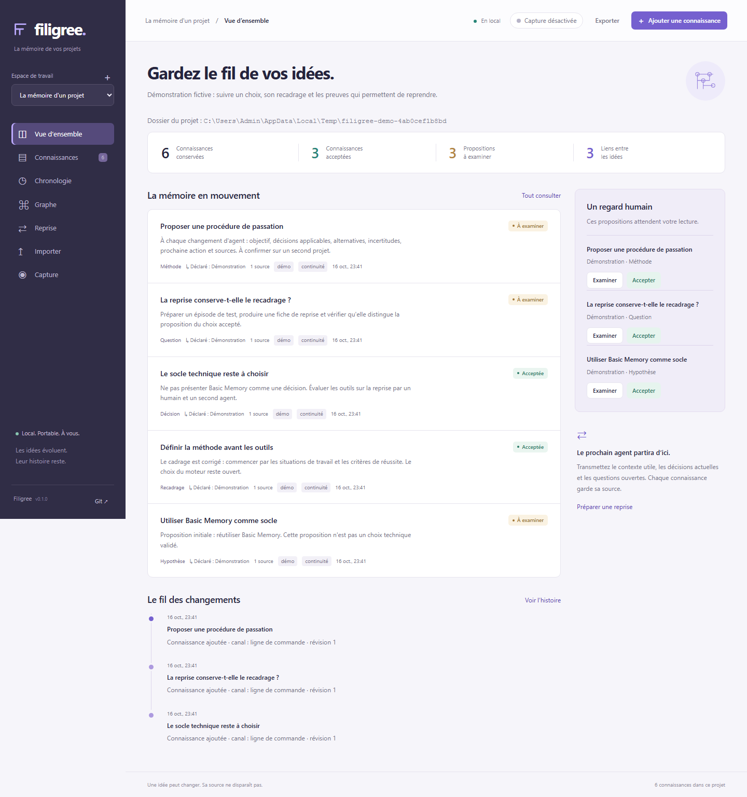

# Filigree

[](https://github.com/TCHINDAJOEL/filigree-memory/actions/workflows/ci.yml)

**Keep the why.** A local, living project memory for people and AI agents.

Your repository remembers what changed. Filigree helps preserve **why it changed**: the proposal, the correction, the rejected option, the source, and the decision that followed.

> v0.2 · Python 3.11+ · Zero runtime dependencies · Local web interface · Permanent local observer · MCP stdio · MIT



*The screenshot shows the fictional demo project. `npm test` regenerates it at `.github/assets/workbench.png`.*

## Quickstart: a memory that follows your folders

📖 **[Guide d'utilisation illustré (français)](docs/guide/README.md)**: installation, every screen, agents, hooks, troubleshooting.

```sh
git clone https://github.com/TCHINDAJOEL/filigree-memory.git && cd filigree-memory
python -m pip install .                                    # Python 3.11+, no runtime dependency
export FILIGREE_DATA_DIR=~/FiligreeMemory                  # Windows: $env:FILIGREE_DATA_DIR="E:\FiligreeMemory"
filigree setup --root ~/code                               # the only folders Filigree may observe
filigree create "My app" --folder ~/code/my-app            # a project is a real folder
filigree agent                                             # workbench on http://127.0.0.1:7820 + capture + activity journal
filigree mcp-config --client claude                        # prints the MCP snippet; you install it once
cd ~/code/my-app && claude                                 # or: codex
```

Optional, each one explicit and reversible:

```sh
filigree service install            # start the agent at login (HKCU Run key / LaunchAgent / systemd --user)
filigree hooks install --client claude --inject --dry-run   # shows the diff first; drop --dry-run to apply (backup kept)
filigree status                     # everything Filigree installed or runs, as JSON
filigree probe                      # read-only: which local agent sources are readable (counts only)
```

While the server (or `filigree capture start --background`) runs, a Claude Code or Codex session started in a real folder files **proposals** under a project bound to that folder, created on first use. On 2026-10-16, on the current build, real Claude Code runs passed: a writer/reader journey with real-browser acceptance and MCP retrieval (Sonnet), claude-tap capture, direct-launch capture and an MCP handoff (Haiku). Each is a single synthetic run on one machine, not a guarantee for other clients or versions; see the [execution report](.aiwg/testing/release-execution.md). Codex compatibility is covered by synthetic fixtures only, not a real-client run. Nothing becomes a decision until you accept it in *Connaissances*. Details, delays and limits are under [Automatic capture](#automatic-capture-bound-to-your-project-folders).

## What v0.2 adds: a permanent local observer

| Command | What it does | Writes outside the data folder? |
| --- | --- | --- |
| `filigree agent` | One background process per data folder: workbench + API, v0.1 capture, activity journal, session sheets | No |
| `filigree setup --root DIR` | Confines observation and project creation to these folders (`--any-folder` restores v0.1) | No |
| `filigree service install` | Starts the agent at login, per user, no admin rights | Yes: one registry value / LaunchAgent / systemd user unit |
| `filigree hooks install --client claude\|codex` | Session start/end signals; `--inject` adds the project's **accepted** knowledge to new Claude sessions | Yes: your Claude `settings.json` or Codex `config.toml`, with a timestamped backup |
| `filigree import-export FILE --project ID` | ChatGPT or claude.ai export (`.json` or `.zip`) → proposals in an explicit project | No |
| `filigree activity ID` · `probe` · `status` | Read-only reports (JSON) | No |

- **Activity journal.** Each project gets `projects/<id>/.filigree/activity.sqlite`: prompts, file changes, commands (program name only, never the command line), test outcomes, errors and commits, extracted deterministically from the Claude Code and Codex transcripts of sessions started in that project's folder. Summaries are redacted before being cut to 280 characters; reasoning and injected blocks are excluded. It is unreviewed evidence, kept 90 days by default, never committed by Git checkpoints and never exported.
- **Session sheets.** After 10 idle minutes (or a session-end signal) each session becomes **one proposal** in *Connaissances*, revised while it is still a proposal; once you accept or reject it, new activity creates a separate "suite" proposal. No model is called.
- **Overlaps.** The *Activité* view and the `active_sessions` MCP tool show files changed by more than one session in the last 15 minutes.
- **No catch-up.** Transcripts that exist when the observer first runs are not read backwards; only new activity is journaled.

The design and its trade-offs are in [ADR-0003](.aiwg/architecture/ADR-0003-permanent-observer.md); executed evidence is in [.aiwg/testing/](.aiwg/testing/v2-1-resolution-auth.md).

## Try it in two minutes

From this repository:

```sh
python -m filigree --data-dir .filigree-data serve
```

Open **http://127.0.0.1:7820** and choose **Explorer la démonstration**. No account, API key, database server or frontend build is required. The interface is in French; knowledge can be written in any language.

Or install the local package:

```sh
python -m pip install .
filigree --data-dir /absolute/path/to/memory serve
```

The default data directory, when omitted, is `~/.filigree`. Use the same absolute directory for the web app, CLI and MCP clients. On Windows, a path such as `E:\MesMemoires` works.

## The moment Filigree is built for

An assistant suggests Basic Memory. You say: “Define the method before choosing tools.” Three days later, another developer or agent joins.

A faithful handoff should say **the tool choice is still open**, show the original suggestion and your correction, and point to the sources. Repeating a suggestion must not turn it into a decision.

Filigree gives this history a usable shape:

- **A workbench for humans:** projects, source excerpts, search, review queue, revision history and a relationship graph.
- **Explicit governance:** proposed, accepted, rejected and superseded are different states. Accepted means you retained it, not that it was independently proven.
- **A shared handoff:** current knowledge, uncertainty and historical alternatives stay clearly separated, with stable references.
- **A portable memory:** structured Markdown is the source of truth. Git checkpoints belong to a dedicated memory repository, separate from your code.
- **An agent interface:** MCP clients can discover projects, search, retrieve handoffs and propose knowledge. Approval stays in the human interface.

## A small, complete workflow

1. Create a project bound to an existing local folder and describe its purpose.
2. Write a note or import a supported conversation/export. Imports create **observations awaiting review**, not automatic decisions.
3. Give important knowledge a type, episode label, sources and relationships.
4. Accept, reject or replace it. Record a reason when useful; inspect earlier revisions in the detail view.
5. Explore the graph, export the documentation or prepare a handoff for the next person or agent.
6. Create a Git checkpoint. Review selected source excerpts and history before pushing to your own remote.

## Bring your existing tools

```sh
python -m filigree --data-dir .filigree-data projects
python -m filigree --data-dir .filigree-data import PROJECT_ID examples/events.jsonl
python -m filigree --data-dir .filigree-data handoff PROJECT_ID --query "cadrage"
```

Supported inputs: normalized JSON events, JSONL, plain `.txt`/`.md` notes, Claude Code visible conversation records, Codex `response_item` messages, and documented claude-tap raw JSONL/full JSON exports. The fixtures in `examples/` are synthetic. Compact `.ctap.json` bundles and WebSocket-only traces are not supported; unsupported records are not a promise of complete transcript fidelity.

For claude-tap, use its **full JSON export**, not the compact default:

```sh
claude-tap export --session-id SESSION_ID --format json -o session.json
python -m filigree --data-dir .filigree-data import PROJECT_ID session.json
```

To watch one explicitly selected export file:

```sh
python -m filigree --data-dir .filigree-data watch PROJECT_ID session.json
```

Watching does not launch an agent or read all conversations on your computer. A changing export is reimported with deduplication; invalid/incomplete writes are retried on the next poll. Original trace files remain outside the memory repository.

### MCP

After installing the package, configure your MCP-capable client using [examples/mcp.json](examples/mcp.json), replacing the data path with an absolute path. The server command is:

```sh
python -m filigree --data-dir /absolute/path/to/memory mcp
```

Tools: `list_projects`, `project_for_folder`, `search_memory`, `get_handoff` (option `accepted_only`), `propose_memory`, and the read-only `project_activity` and `active_sessions` (unreviewed journal data). `project_for_folder` is read-only: it returns the project registered for an absolute folder (nearest registered ancestor) and never creates one.

Since v0.2 the server is **scoped to one project**: the one registered for its working directory (MCP clients start it in your project folder), or the one given by `--project-folder DIR`. `--all-projects` serves every project explicitly. A call outside the scope is refused.

To see the exact configuration for your client, run `filigree --data-dir /absolute/path/to/memory mcp-config --client claude` (or `codex`). It only **prints** the snippet; you install it yourself, once, and Filigree never edits an agent configuration, `CLAUDE.md` or `AGENTS.md`. Without that MCP configuration, an agent cannot recall the memory; automatic capture only *writes* proposals. The transport implements the MCP 2025-11-25 initialization and tools subset over stdio. It does not claim certification or integration testing with every client. See [the integration contract](.aiwg/architecture/claude-tap-integration.md).

## Architecture

```text
 claude-tap SQLite (read-only, schema v4) ──┐                         ┌─ Web workbench  (127.0.0.1, local key on every API call)
 native Claude / Codex transcripts ─────────┤  capture monitor        ├─ CLI            (filigree …)
   (sessionId + cwd; new lines, fallback)   ├─ exact session id ──▶  Store ─ MCP stdio   (scoped; read + propose only)
 explicit imports (JSON, JSONL, notes) ─────┘  → folder → project     └─ Markdown files + optional Git checkpoints
 chat exports (ChatGPT, claude.ai) ──────────── explicit project ──▶  Store
 collectors (Claude Code, Desktop, Codex) ──▶ activity observer ──▶ activity.sqlite per project ──▶ session-sheet proposals
                                     filigree agent runs all of the above in one process per data folder
```

- `filigree/store.py` is the single writer: Markdown entries with a JSON metadata block, revision history, an event journal and one workspace lock shared by every process.
- `filigree/tap_source.py` and `filigree/native_index.py` are read-only adapters (stdlib `sqlite3` and file reads); nothing from claude-tap is imported or executed.
- `filigree/capture.py` links a record to a folder only through an identifier that is **exactly** equal on both sides, then imports proposals with provenance. State lives in `<data-dir>/.capture/`, outside every project and Git checkpoint.
- `filigree/server.py` serves the static UI and a JSON API on loopback only; `filigree/mcp.py` exposes the same store to agents without any acceptance tool.
- `filigree/collectors/` reads session metadata (never message text) from Claude Code, Claude Desktop and Codex, read-only and bounded; `filigree/resolver.py` holds the allowed-roots and proven-worktree rules.
- `filigree/extract.py`, `filigree/activity.py` and `filigree/distill.py` build the activity journal and the session sheets; `filigree/agent.py`, `filigree/service.py` and `filigree/hooks.py` are the daemon, the optional autostart and the optional hooks.

Decisions: [ADR-0001](.aiwg/architecture/ADR-0001-local-portable-memory.md) (portable memory), [ADR-0002](.aiwg/architecture/ADR-0002-automatic-project-capture.md) (capture), [ADR-0003](.aiwg/architecture/ADR-0003-permanent-observer.md) (permanent observer) and [the claude-tap contract](.aiwg/architecture/claude-tap-integration.md).

## Automatic capture, bound to your project folders

A project is a **real local folder**. Create it from the interface (the folder must already exist, as an absolute path) or with `filigree create NAME --folder /absolute/path`. Projects created by an older version show as *sans dossier*; attach a folder from the overview or with `filigree attach PROJECT_ID /absolute/path`. One folder belongs to one project; Claude and Codex sessions started in the same folder (or below it) land in the same project.

`filigree serve` starts a capture monitor by default (`--no-capture` disables it; use it for any test or packaging server). The monitor has two sources: the claude-tap SQLite store (read-only, schema v4 only) and, for clients launched **directly** (a plain `claude` or `codex` command, no claude-tap), the local transcripts those clients write. Both keep:

- visible user and assistant text, plus bounded tool calls and tool results (commands, errors, validation output) and HTTP failures (status and a short error snippet);
- never hidden thinking/reasoning (thinking blocks, Codex messages on the `analysis` channel and similar internal-reasoning variants, in both sources), system or developer prompts, or injected instruction blocks (`<environment_context>`, `<system-reminder>`, …). Only the **new** turn of each exchange is stored, not the whole repeated history. Secret-looking strings are redacted heuristically.

Everything arrives as **proposals** with tags and provenance (tap database hash, tap session, record index and payload hash, native session id, folder, link mode) stored inside the entry, so a Git checkpoint keeps it. No LLM is called and no decision is extracted.

**How a session finds its folder.** claude-tap records no working directory. Filigree takes the native session identifier claimed by a record (Claude Code session header or `metadata.user_id`; Codex turn metadata or `session_id`) and looks for **exactly that identifier** in the local Claude (`projects/**/*.jsonl`) or Codex (`sessions/**/*.jsonl`) transcripts, reading only `sessionId`/`session_meta.id` and `cwd`. When one valid folder results, the project is the nearest registered ancestor; if none exists, one is created for the nearest Git root, or for that folder itself when the root is your home folder, contains it, or is a drive root (so a dotfiles repository cannot merge unrelated folders). Codex announces both `session_id` and `thread_id`; both are read and any divergence is a conflict. Nothing is ever guessed from recency, timestamps or names: unknown, conflicting or ambiguous identities stay **pending** (keys only, no content) in the *Capture* view or `filigree capture pending`, until you map them with `filigree capture link KEY PROJECT_ID`. Your explicit choice for a conflicting `tap:SESSION` is honored, never replaced by a software guess; the entries record `link: explicit`, the claimed ids and the folder **you chose** (`target_folder`), and say that this is not native-transcript proof. Two contradictory mappings for one session stay pending (`mapping_conflict`).

**Directly launched clients (native fallback, on by default).** A plain `claude` or `codex` session needs no wrapper: its transcript names its own session and folder, so the monitor reads new complete lines and files them under the folder's project (created on first use). Expect a delay of up to about a minute (a short grace lets claude-tap record the same turn first; a file written continuously is read anyway after `FALLBACK_MAX_WAIT`), and only complete lines are read. Switching between claude-tap and direct launch does not duplicate messages: each channel keeps a bounded, expiring (15 min) ledger of content digests per native session and skips an item the other channel already filed; an identical message sent later, or after the window, is new activity, so a session that once used claude-tap is never muted. A native line whose session cannot be placed yet (index not caught up, folder missing, several folders, no project and auto-creation off) is **held, not skipped**: the file offset stays at that line, the session appears as pending (key and reason only, no text; the content remains in the agent's own transcript), and the file is read again from there once the session resolves or you map it with `filigree capture link SESSION_ID PROJECT_ID`. Order is kept and nothing is imported twice. A deliberate pause or exclusion skips what is written meanwhile, for good; lines that were already held before a global pause or disablement began are still caught up once their session resolves (only the paused interval is dropped). At most 100 files are held; beyond that the loss is counted and noticed, never silent. Turn the fallback off with `filigree capture fallback off`. The default applies only when `capture.json` does not mention it: earlier versions saved the whole settings object (including `"native_fallback": false`) as soon as any setting was changed, so such an installation stays off until you run `filigree capture fallback on`.

**Only the future.** The first scan records a baseline: sessions and transcripts that already exist are ignored, and so are periods when capture was paused or disabled. `capture link ... --import-history` imports older records of a mapped claude-tap session, explicitly.

```sh
filigree capture status            # monitor, claude-tap source, counters, pending
filigree capture start --background   # or: filigree capture run
filigree capture pause | resume [--project ID]
filigree capture exclude FOLDER | include FOLDER
filigree capture disable | enable
filigree capture fallback on | off # native-transcript source for directly launched clients
filigree capture stop              # cooperative stop file; no process is killed
```

State (cursors, pending keys, mappings, settings in `capture.json`) lives in `<data-dir>/.capture/`, outside every project and Git checkpoint. An OS-held lock allows one monitor per data directory; changes to settings and mappings are serialized across processes by the store's workspace lock. If the claude-tap database path changes, pending keys (which name sessions and record indexes of the old database) are moved to `pending.quarantine-*.json` (keys only; the last five are kept) instead of being replayed against an unrelated database. A `tap:SESSION` mapping is stored together with the identity of the database it was chosen against and applies only to that database (`mappings_other_database` in `capture status` counts the others); a native session id mapping is not database-bound. Mappings written by an earlier build without this scope are never applied. `scripts/install-capture-startup.ps1` is an **optional**, explicit, per-user Windows login shortcut (no admin; asks for confirmation); `scripts/uninstall-capture-startup.ps1` removes it.

**Limits, stated plainly.**

- The monitor must be running to capture. Filigree does not hook, wrap or intercept any application.
- claude-tap records only clients launched through it; direct launches rely on the native-transcript fallback, which needs a local Claude Code or Codex transcript. The Claude desktop chat tab and Claude on the web are not covered. Sessions whose folder cannot be established stay pending (claude-tap) or are held at their file offset (native fallback, bounded at 100 files); both are listed without text. Nothing is attributed to a folder by guesswork.
- The native fallback passed a real Claude Code direct-launch check on 2026-10-16 (one synthetic run); Codex has only been tested with synthetic transcripts. Parsing relies on transcript layouts that those tools may change. Only `*.jsonl` below the configured roots (depth ≤ 6) are scanned; a rewrite of a transcript to a **larger** size inside the already-read region is not detected, a same-size rewrite is (by modification time) and drops the earlier folder match.
- Cross-channel de-duplication is by exact visible text (per native session, 15-minute window). A client that rewrites text between its transcript and its API request would be filed twice; the result is a duplicate proposal, never a lost one.
- Identifiers and `capture.client` are claims in local data, not authentication.
- A tool call or result may contain sensitive output; redaction is heuristic and best-effort, never a DLP guarantee. Review proposals before accepting or publishing them. Masked: known token shapes (`sk-ant-…`, `ghp_…`, `github_pat_…`, `xox?-…`, AWS, JWT, …), `Authorization`/`Cookie` headers, PEM private keys, `scheme://user:password@` URLs (a raw `/` in the password is masked, the password part is bounded to 128 characters) and secret-named assignments (`password=…`, `"api_key": "…"`). Known limits: generic token shapes (`AKIA…`, `npm_`, `hf_`, `eyJ…`, bare `sk-`, `sk_live_`) are masked only when not glued to preceding word characters; a masked glued token also swallows the alphanumerics that follow it; a URL password containing `?`, `#` or `@`, longer than 128 characters, or starting like a port (`u:12345/x@h`) is not fully masked; a benign link such as `https://host:abc/x@y` may be masked (false positive); a multi-word secret that does not start a line (`password: my phrase` is masked to end of line only at the start of a line); secrets with no recognisable shape or name; anything split across separate fields. Text is redacted in full **before** any title/excerpt/body is cut, and Git checkpoint messages are redacted the same way.
- **Review is local, not authenticated.** “Accepted” means accepted through the local review interface; Filigree cannot prove who clicked, because any process of the same user can read the page token or edit the Markdown files. Each entry and each change event records a server-set `channel` (`http-ui`, `mcp`, `import`, `capture`, `local`) that a client cannot supply; `agent` is only a label the client declares. MCP can only propose.
- Actor names are shown as **declared**, not authenticated; editing one (or a title/body of a superseded entry) adds an append-only revision and event. Unreadable memory files are announced in the interface (banner) rather than silently left out. See the trust boundary in [SECURITY.md](SECURITY.md).
- To undo a replacement, create a new **accepted** entry that restates the old choice and `supersedes` the current one; a superseded entry is never reactivated and its history stays.
- claude-tap's schema is an internal contract: any other version is reported as `unsupported_schema` and nothing is read. SQLite may create a `-shm` file next to a WAL database when opened read-only.
- Rewritten or deleted tap sessions are counted and shown; the memory is never rewritten or deleted for them. Rewrites are detected on recently captured records only.
- Only the verified one-token warm-up (`max_tokens: 1`) is skipped. Other auxiliary or tool-less requests (titles, summaries, structured output) are not filtered by guesswork: they can be captured as **proposals** (identity-filtered to the right project, never auto-accepted) and appear as noise you can reject.
- Performance, measured once on one machine, no SLA: importing 3000 entries took about 65 s; a loop of `create_entry` reached 1586 entries in 180 s (per-entry writes slow down as a project grows, so load thousands of entries by import); a cold handoff at 3000 entries took about 2.8 s; one 14 s handoff outlier was seen once, not reproduced and not attributed to a cause.
- The synthetic live-test sessions (writer and reader) also reside in the normal Claude configuration transcripts, because the helper locates its exact session there; they contain only synthetic text.
- Fallback entries are labelled `repli-natif` and carry `collector: native-fallback` in their provenance, distinct from `claude-tap` entries.

## Where the knowledge lives

```text
memory/
  projects/<stable-project-id>/
    project.json
    .filigree/
      entries/<stable-entry-id>.md
      history/<stable-entry-id>/<revision>.md
      events/<event-id>.json
      imports.json
      activity.sqlite        # v0.2 journal: kept data, never in a Git checkpoint or an export
  .capture/                  # capture.json settings, capture and observer state
  .runtime/                  # agent.key, agent.json, signals.jsonl, install-log.jsonl, agent.log
```

Each project's `project.json` holds its `folder` (`path` and `key`). Capture state is separate, under `<data-dir>/.capture/`. `filigree status` lists every artifact present. The journal cannot be rebuilt once the agents have purged their own transcripts.

Each entry contains readable Markdown plus a fenced JSON metadata block. No database reconstruction is required: restart the app against the copied data directory. A cloned project memory repository belongs under `memory/projects/<its-original-id>/`; its `project.json` retains that ID. Read the [portability guide](.aiwg/deployment/user-guide.md) before moving or editing files.

## Boundaries we make explicit

Filigree deliberately provides a local workflow with visible sources and human review. It does **not** automatically extract reliable decisions from free conversation, detect contradictions with a model, recover hidden model reasoning, learn personal habits across projects, or synchronize multiple users. Episode labels group notes; they are not autonomous task objects yet. Search is lexical, and relationships are explicit.

There is no cloud telemetry and no model call in the application (v0.2 included: session sheets are deterministic digests). Claude Desktop sessions are listed from metadata only; their content is captured only through the matching Claude Code transcript, when one exists. Codex rollouts compressed as `.zst` are reported, not read. macOS and Linux autostart plans are tested synthetically; Windows is the reference platform. Imported text can still contain sensitive information. Secret filtering is heuristic; review material before publication. The local server is not suitable for public hosting. See [SECURITY.md](SECURITY.md).

These boundaries are part of the design, with a [roadmap and acceptance criteria](.aiwg/planning/delivery-plan.md), rather than features silently simulated in the demo.

## Develop and evaluate

```sh
python -m unittest discover -s tests -v        # Python suite, synthetic data only
node --check filigree/static/app.js
npm ci
npx playwright install chromium
npm test                                       # browser journeys; the server runs with --no-capture
python -m pip wheel . --no-deps --wheel-dir .runtime/wheels
python scripts/verify_package.py               # isolated wheel install, packaged UI, served with --no-capture
python scripts/verify_agent_e2e.py             # real `filigree agent` process, synthetic transcript, no model call
```

Node is a development-only dependency. The Python tests cover persistence, provenance, governance, concurrent writers, recovery, imports, MCP, HTTP boundaries, Git clone portability and capture. Browser tests exercise actual user journeys. CI is configured for Windows/Linux/macOS and Python 3.11/3.14; the [verification report](.aiwg/testing/verification.md) distinguishes local evidence, source-only checks and CI runs.

`scripts/verify_live_observer.py` (v0.2) is a manual, opt-in live check of the observer: a real `filigree agent` must journal one real Claude Code (haiku) session started in a synthetic folder and propose its session sheet. Latest results of all live checks: [v2-live-verification.md](.aiwg/testing/v2-live-verification.md).

`scripts/verify_live_capture.py` is a separate, **manual, opt-in** smoke check outside the suites above: it makes one bounded `claude-tap` call (Claude Code, model `haiku`, 300 s, no retry) in a synthetic folder, against a fresh claude-tap database and memory under `.runtime/live-capture/`. It consumes model quota and proves one client on one machine only. `--check-only` verifies the isolation without calling Claude.

## Contributing

1. Read [AGENTS.md](AGENTS.md) and the story you touch in [user-stories.md](.aiwg/requirements/user-stories.md); keep documentation claims equal to behavior.
2. Write a failing behavioral test first, with synthetic data only (never a real transcript, trace or credential).
3. Run the commands above and report what you actually ran, plus the limitations that remain.
4. Open a small pull request with a conventional commit title. See [CONTRIBUTING.md](CONTRIBUTING.md) and [SECURITY.md](SECURITY.md).

- [Guide en français et démonstration](.aiwg/deployment/user-guide.md)
- [Product vision](.aiwg/requirements/vision.md) and [user stories](.aiwg/requirements/user-stories.md)
- [Architecture and alternatives](.aiwg/architecture/ADR-0001-local-portable-memory.md)
- [Independent reviews and synthesis](.aiwg/testing/review-synthesis.md)
- [Contributing](CONTRIBUTING.md) · [MIT license](LICENSE)
